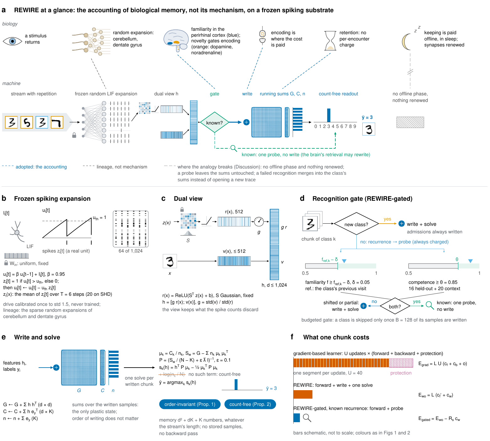
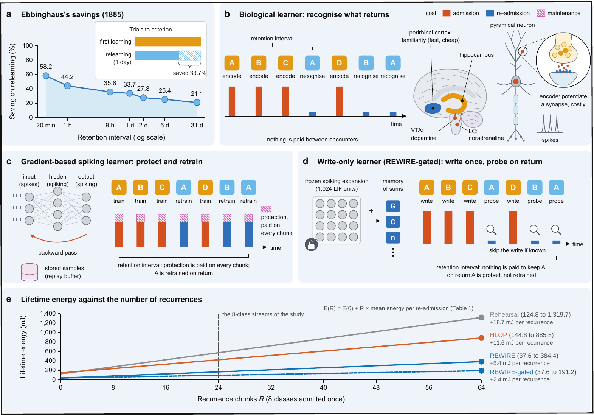
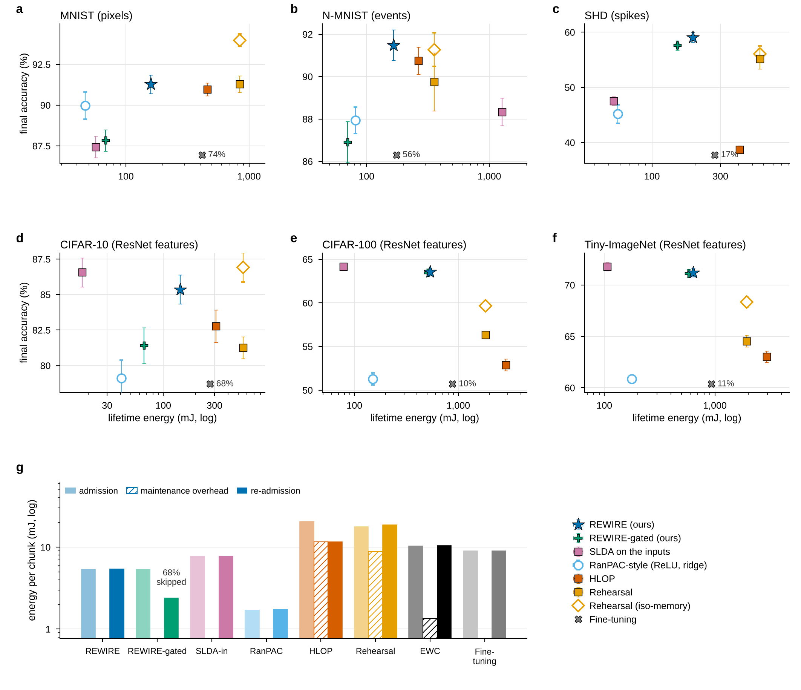
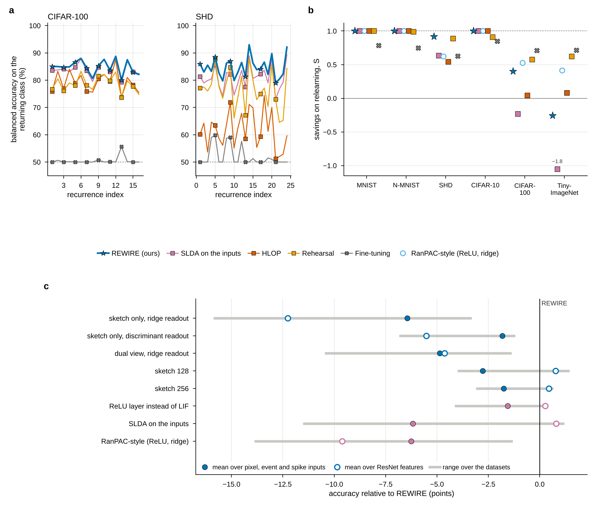
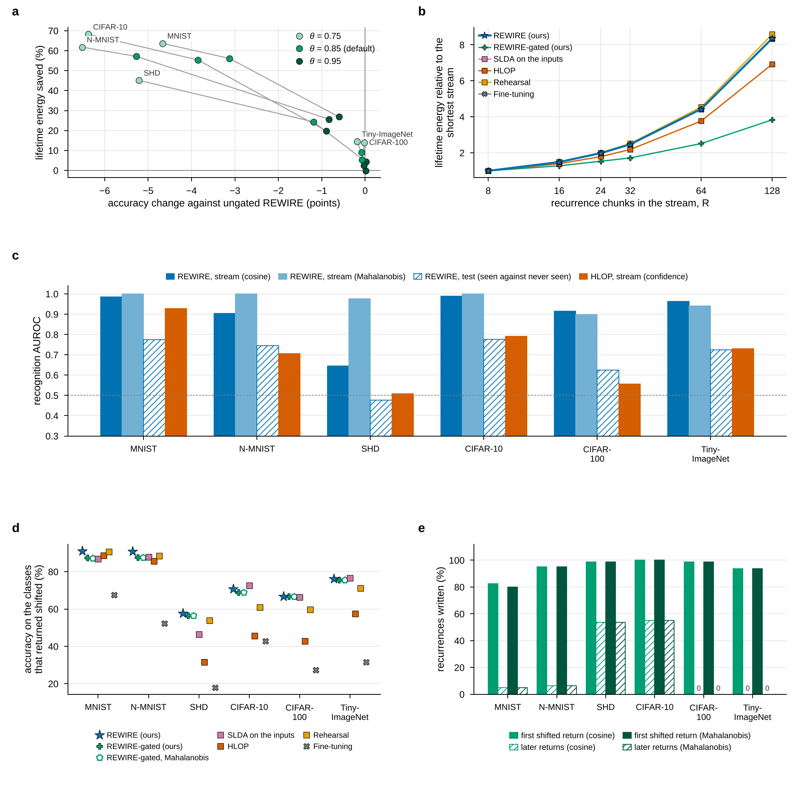
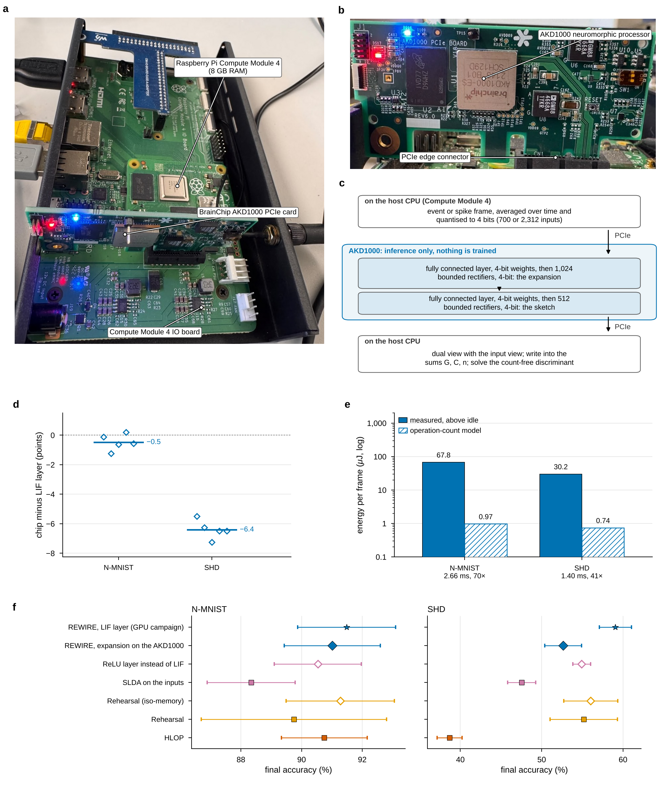

# REWIRE

Code, run records and figures for the article

> **Write-only continual learning: a spiking memory that retains for free and recognises what returns**<br>
> Aftab Hussain and Alois Ferscha, Institute of Pervasive Computing, Johannes Kepler University Linz (manuscript under review)

Biological learners pay nothing per encounter to keep what they know, and they recognise what returns. Spiking continual
learners do the opposite: they protect their network on every update and retrain a class that returns. REWIRE is a continual
learner whose only learning operation is a *write*. A frozen random spiking (LIF) expansion of 1,024 units feeds a dual view, a
sketch of its firing rates beside a view of the input, into a memory held as three running sums (G, C, n), and the readout, a
count-free linear discriminant, is solved from the sums in closed form. No parameter is trained by gradient descent. The readout
does not depend on the order of the stream and equals the joint fit on everything written (Proposition 1); it carries no class
prior, so repetition enters only as a weight on the shared covariance (Proposition 2). A recognition gate decides whether a
returning class is written again or only probed, which turns re-admission into an energy-accuracy operating curve.

<p align="center"></p>

**REWIRE at a glance (Fig. 2).** **a**, Top, the biological account the design borrows; bottom, the machine: a stream with
repetition (pixels, events, spike trains or, for natural images, the features of a frozen ResNet-18 shared by every method)
reaches a frozen random LIF expansion; a sketch of its rates beside a view of the input forms the dual view *h*; the gate decides
whether a returning chunk is written; a write adds to the running sums (G, C, n), from which the count-free readout is solved in
closed form. **b**-**f**, The LIF expansion, the dual view, the recognition gate, the write and the solve, and what one chunk costs.

## The idea

<p align="center"></p>

**From Ebbinghaus to the three costs (Fig. 1).** A biological learner encodes a novel stimulus at a cost and recognises a
returning one cheaply, paying nothing between encounters to protect what it knows (**b**). A gradient-based spiking continual
learner trains and protects on every chunk and retrains a returning class as if it were new (**c**). A write-only learner pays one
write and one solve for a new class, one probe for a returning class it recognises and one write otherwise, with no protection
term (**d**). Panel **e** gives the lifetime energy against the number of recurrences from the measured cost of a re-admission.

## Results at a glance

Every number below is computed from the records in this repository (`paper_results/facts.json`) and is the value the article quotes.

* **Benchmark.** Class-incremental learning with repetition on six datasets (MNIST, N-MNIST, SHD, CIFAR-10, CIFAR-100 and
  Tiny-ImageNet), 29 methods and variants and five seeds: 870 runs in the main comparison, on one protocol, one width and one
  energy model.
* **Accuracy and energy.** REWIRE is within 2 points of HLOP and two rehearsal baselines of equal width, or ahead of them, on five
  of the six datasets, at 1.6-5.4 times less modelled lifetime energy (operation-count model at 45 nm).
* **Retention and recognition.** A returning class keeps 84.7-95.9% balanced accuracy before anything is written, and REWIRE
  recognises it with AUROC 0.65-0.99.
* **Hardware.** A 4-bit rectifier version of the expansion runs on a BrainChip AKD1000 neuromorphic processor in an edge node of
  our laboratory (Raspberry Pi Compute Module 4, 8 GB): 91.0% on N-MNIST and 52.7% on SHD, 0.5 and 6.4 points below the LIF layer,
  at 375 and 716 frames per second and 67.8 and 30.2 µJ per frame above the chip's 0.90 W idle floor. MetaTF's software model of
  the converted network gave the same accuracy as the chip on all 10 seeds.

**Accuracy against lifetime energy, and the three costs (Fig. 3).** Final accuracy against lifetime energy on each dataset
(**a**-**f**; up and to the left is better) and the energy per chunk by cost (**g**): admission, maintenance overhead above
fine-tuning (zero by construction for the write-only learners) and re-admission.

<p align="center"></p>

**What survives the retention interval, what restoring it costs and what each component contributes (Fig. 4).** Retention at
re-admission on CIFAR-100 and SHD (**a**), savings on relearning per dataset (**b**) and the ablation ladder with the
gradient-free controls (**c**).

<p align="center"></p>

**The gate, recurrence density, recognition and classes that return from a shifted domain (Fig. 5).** The gate as an operating
curve (**a**), lifetime energy against the number of recurrence chunks (**b**), recognition AUROC (**c**) and the classes that
return from a shifted domain (**d**, **e**).

<p align="center"></p>

**REWIRE on a neuromorphic edge node (Extended Data Fig. 9).** The node and the AKD1000 card (**a**, **b**), what runs where
(**c**), the accuracy of the chip's features against the LIF layer seed by seed (**d**), the energy per frame against the
operation-count model (**e**) and the chip's accuracy among the campaign's methods (**f**).

<p align="center"></p>

## Repository layout

```
rewire/                      the Python package
  configure.py               every setting: protocol, learners, cost model, presets, per-dataset settings (including the domain shift)
  models/arms.py             every learner behind one interface, and the registry ARMS (names, groups, labels)
  engine.py                  the stream, the metrics, the recovery and recognition probes
  native.py                  task- and domain-incremental protocols (and the baselines' fidelity check)
  campaign.py, worker.py     grids, sweeps and reports; one (dataset, seed, stage) unit of work
  dataloader/, modules/      loaders, the frozen front end and the stream generator; the LIF network and the cost meter
  metrics/stats.py           exact Wilcoxon signed-rank test, Holm correction, bootstrap intervals
  report/                    the paper's figures, tables and named values, computed from the saved records
  baselines/hlop_official/   the HLOP authors' Hebbian module, unmodified (Apache 2.0)
scripts/                     prepare_data.py, run_all.py (the campaign), merge_results.py, make_paper_figures.py
hardware/akida/              the expansion on a BrainChip Akida processor: probe, measurement, data extraction (see its README)
tests/, selftest.py          Propositions 1 and 2 as tests; every learner end to end on a synthetic stream
rewire/preflight.py          the properties the paper relies on, as checks
records/results_2026-10-29_1457/   the run records of the article: the GPU campaign and the node measurement (hardware/)
paper_results/               every figure, table and named value of the article, regenerated from records/
docs/diagrams/               the hand-drawn diagrams: Figs 1 and 2, Extended Data Figs 1, 2 and 5 (PDF, with PNG copies)
```

Learner names in the code: `rewire` is the proposed method and `rewire_gated*` its gate variants; `abl_*` are the one-factor
ablations (the ladder starts from `abl_sketch_ridge`, the sketch of the expansion alone with a one-hot ridge readout); `ctrl_*`,
`ranpac`, `ridge_input` and `hd_memory` are the gradient-free controls; `hlop*`, `replay*`, `ewc` and `naive` are the gradient
baselines; `dsd_snn` runs on the native protocols only. `BASELINES.md` gives the source of every baseline and control.

## Reproducing the article

### 1. Environment

```
git clone https://github.com/Aftab-Hussain302/REWIRE.git
cd REWIRE
bash setup_env.sh && . .venv/bin/activate
```

The campaign ran with Python 3.12.13, PyTorch 2.14.1 and CUDA 12.6 on one NVIDIA RTX A6000 with 6 CPU cores; every package
version is in `records/results_2026-10-29_1457/ENVIRONMENT.md`.

### 2. Checks (no data, CPU, about two minutes)

```
REWIRE_PREFLIGHT_CPU=1 python3 -m rewire.preflight   # the properties the method relies on, the protocol, the energy model, the statistics
python3 selftest.py             # every learner end to end on a short synthetic stream, the native protocols, every figure
python3 -m pytest tests -q      # Propositions 1 and 2 as tests, the discriminant against NumPy, recursive against direct solve
```

Without `REWIRE_PREFLIGHT_CPU=1` the preflight also requires a CUDA GPU, as on the machine that runs the campaign.

### 3. Every figure, table and number from the records (no data, no GPU, about a minute)

```
python3 scripts/make_paper_figures.py --runs records/results_2026-10-29_1457 --name check --out paper_results_check
```

The new folder matches `paper_results/` value for value (37,815 named values in `facts.json`) and table for table; with
matplotlib 3.11 and the Liberation Sans font the figures are identical as well.

### 4. The campaign from scratch (one GPU, about 12 hours)

Put the datasets under one folder (next section), then

```
python3 scripts/prepare_data.py --data_root ~/data
nohup python3 scripts/run_all.py --data_root ~/data > run_all.log 2>&1 &
```

The article's run took 11.9 h. It writes `results/results_<date>_<time>/`, which step 3 reads with `--runs`. `REPRODUCE.md`
describes every stage, the short end-to-end run (`--smoke`), resuming an interrupted run and the run folder.

### 5. The hardware measurement (BrainChip Akida)

```
python3 hardware/akida/probe_akida.py 2>&1 | tee probe_report.txt
python3 hardware/akida/run_akida.py --data_root ~/data --run results/results_<date>_<time> --datasets shd nmnist --backend hw
```

The article used an AKD1000 PCIe card in a Raspberry Pi Compute Module 4 (8 GB) with MetaTF 2.10 and Python 3.11.
`hardware/akida/README.md` describes the conversion of the expansion for Akida 1.0, the power measurement and the software-only
backends for machines without a board.

## Datasets

The datasets are not redistributed. `DATASETS.md` gives the folder layout that `--data_root` expects.

| dataset | source |
|---|---|
| MNIST | http://yann.lecun.com/exdb/mnist/ (torchvision downloads it if absent) |
| N-MNIST | https://www.garrickorchard.com/datasets/n-mnist |
| SHD (and SSC, optional) | https://zenkelab.org/datasets/ |
| CIFAR-10, CIFAR-100 | https://www.cs.toronto.edu/~kriz/cifar.html (torchvision downloads them if absent) |
| Tiny-ImageNet | http://cs231n.stanford.edu/tiny-imagenet-200.zip |

## The records

`records/results_2026-10-29_1457/` is the merged run folder of the article's campaign, with the node measurement under `hardware/`.

| path | what it holds |
|---|---|
| `<dataset>/shift_none/` | the main grid: every learner and seed (`rows.json`, with summaries as CSV) |
| `<dataset>/sweep_recur/n<R>/`, `<dataset>/sweep_gate/t<threshold>/` | the long streams; the gate's competence thresholds |
| `<dataset>/shift_domain/` | the recurrences from a shifted domain |
| `<dataset>/eps_sens/`, `eps/`, `eps_selected.json` | the shrinkage of the discriminant: sensitivity, and its selection on a development stream |
| `native/`, `fidelity/` | the task- and domain-incremental protocols and the fidelity check of the gradient baselines |
| `campaign_leaderboard.csv`, `paired_*.csv`, `pooled_*.csv`, `summary_*.md`, `shift/` | campaign summaries and paired statistics |
| `MANIFEST.json`, `ENVIRONMENT.md`, `determinism.json`, `logs/` | the code hashes, the machine and packages, the repeat check, the log of every unit |
| `hardware/akida_nmnist.json`, `hardware/akida_shd.json` | the node measurement, seed by seed: accuracy with the LIF layer, the software model and the chip; power, frame rate and energy per frame |
| `hardware/probe_report.txt`, `akida_hw.log`, `check_shd_seed0.txt`, `photos/` | the probe of the chip, the log of the measurement, a software-model check of SHD seed 0, the photographs of Extended Data Fig. 9a,b |

Every row of every `rows.json` carries the full configuration of its run, the stream schedule, the per-chunk accuracy and energy,
the visit log and the recognition scores. Left out are the per-unit copies of the run (`parts/`, 160 MB) and the campaign's own
preview figures: the merged files hold the same rows, and `scripts/make_paper_figures.py` redraws every figure from them.

Of the 38 source files whose SHA-256 the run recorded in `MANIFEST.json`, 31 are unchanged in this repository, among them every
file of the method, the baselines, the protocol and the campaign. The seven that changed afterwards are the report code
(`rewire/report/compute.py`, `facts.py`, `figures.py`, `tables.py` and `scripts/make_paper_figures.py`), which only reads the
records, and the two Akida scripts (`hardware/akida/rewire_akida.py`, `run_akida.py`) in the versions that produced the node's
records.

## Where each item of the article is

| article | file |
|---|---|
| Figs 1 and 2 | `docs/diagrams/fig1_concept.pdf`, `fig2_rewire.pdf` (Fig. 1e follows the values of `paper_results/figures/aux_fig1e_reference`) |
| Figs 3-5 | `paper_results/figures/fig3_accuracy_energy_costs`, `fig4_retention_savings_ablation`, `fig5_gate_density_recognition_shift` |
| Table 1 | `paper_results/tables/tab1_main.csv` (and `.tex`) |
| Extended Data Figs 1, 2 and 5 | `docs/diagrams/ed_fig1_scenarios.pdf`, `ed_fig2_properties.pdf`, `ed_fig5_savings_protocol.pdf` |
| Extended Data Figs 3, 4 and 6-9 | `paper_results/figures/ed_fig3_streams` ... `ed_fig9_hardware` |
| Extended Data Table 1 | `paper_results/tables/ed_tab1_native.csv` |
| Supplementary Figs 1 and 2, Supplementary Tables | `paper_results/figures/si_fig1_gate_thresholds`, `si_fig2_shrinkage`; `paper_results/tables/si_tab_*` |
| every number in the text | `paper_results/facts.json` (unrounded) and `paper_results/macros/numbers.tex` (as printed) |
| source data of the figures | `paper_results/source_data/` (one workbook per figure) |

Each figure is in `paper_results/figures/` as EPS, PDF and PNG (300 dpi); `paper_results/README.md` lists them.

## Citation

If you use this code or these records, please cite the article (`CITATION.cff` holds the same information):

```bibtex
@unpublished{hussain2026rewire,
  author = {Hussain, Aftab and Ferscha, Alois},
  title  = {Write-only continual learning: a spiking memory that retains for free and recognises what returns},
  note   = {Manuscript under review},
  year   = {2026}
}
```

A Zenodo archive of this repository with a persistent identifier will be added on publication.

## Licence

Apache License 2.0 (`LICENSE`, `NOTICE`). `rewire/baselines/hlop_official/hlop_module.py` is the Hebbian module of HLOP-SNN
(Xiao et al., ICLR 2024), copied unmodified from the authors' repository under the Apache License 2.0; see the `LICENSE` and
`NOTICE` in that folder.

## Contact

Aftab Hussain, Institute of Pervasive Computing, Johannes Kepler University Linz (aftab.hussain@jku.at).
